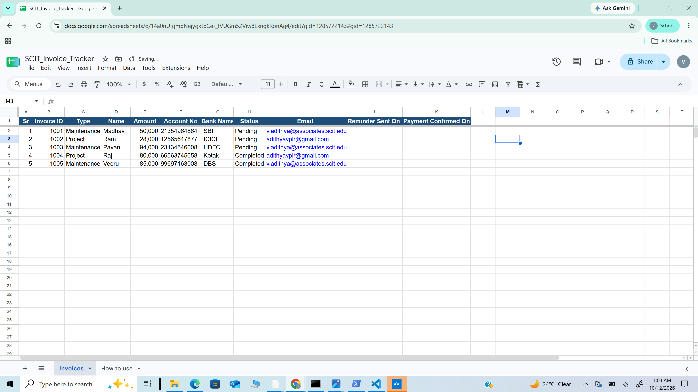
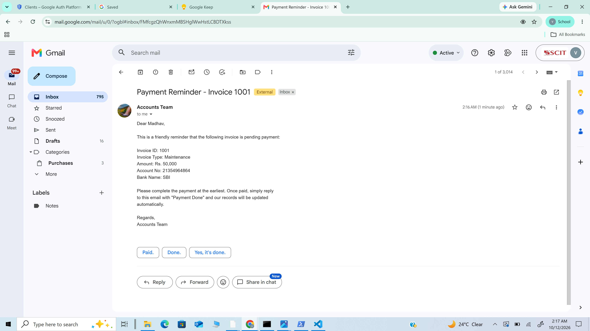
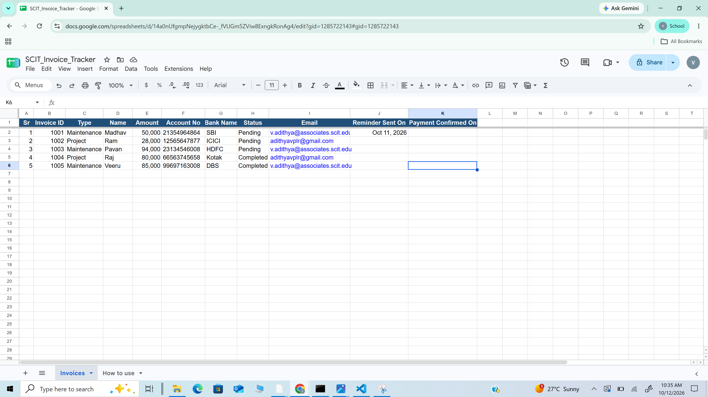
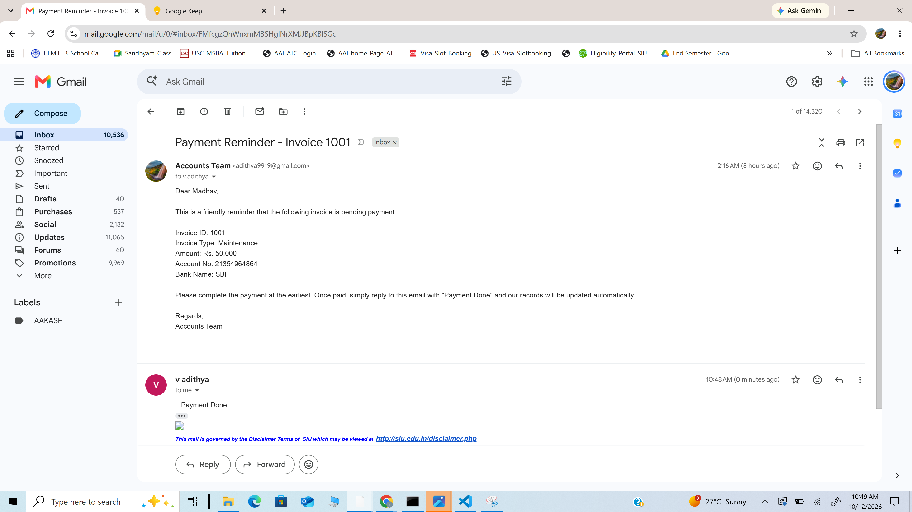
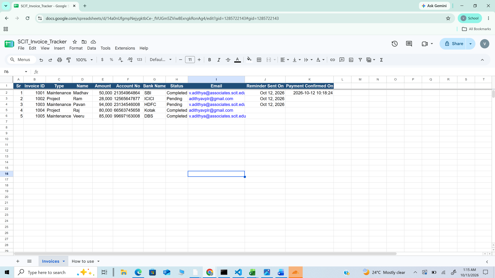
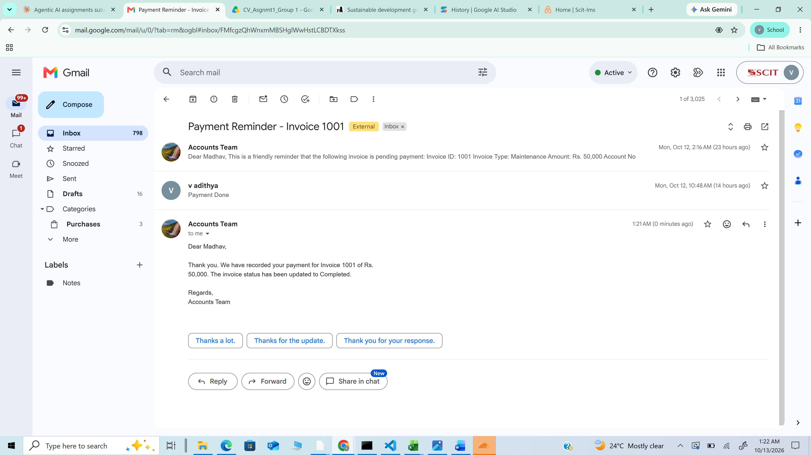

# Assignment 1 – Scheduled Invoice Payment Reminders with Reply Handling (Zapier)

> **Status:** Both Zaps are built, tested and published.

## 1. Problem Statement

The accounts team tracks invoices in a spreadsheet. Every day someone has to check which invoices are still **Pending**, email each party a reminder, and later, when a party replies that the payment is done, find the invoice and mark it **Completed**. This is repetitive and easy to miss.

This assignment automates the full loop with Zapier:

1. **Zap 1 – Scheduled Payment Reminder:** every morning, read the invoice sheet, pick the Pending invoices, send each party a personalised reminder email, and log when the reminder was sent.
2. **Zap 2 – Reply Handling (Payment Confirmation):** when a party replies "Payment Done", extract the Invoice ID from the email subject, update that invoice to Completed with the confirmation date, and send an automatic acknowledgement reply.

## 2. Tools Used

| Tool | Purpose |
|---|---|
| Schedule by Zapier | Daily trigger at 9:00 AM IST |
| Google Sheets | Invoice tracker (data source and status log) |
| Looping by Zapier | Process each pending invoice separately |
| Gmail | Send reminders, watch for replies, send acknowledgement |
| Filter by Zapier | Only continue for genuine "Payment Done" replies |
| Formatter by Zapier | Extract the Invoice ID from the reply's subject |

**LLM used:** None. This assignment is rule-based workflow automation; no language model is involved. The email text is a fixed template with dynamic fields (see `Prompt.md`).

## 3. Input Data

`SCIT_Invoice_Tracker.xlsx` is the invoice table given in class (Sr, Invoice ID, Type, Name, Amount, Account No, Bank Name, Status) with three columns added for the automation:

| Column | Filled by | Purpose |
|---|---|---|
| Email | You (test addresses) | Where the reminder is sent |
| Reminder Sent On | Zap 1 | Audit trail of when the reminder went out |
| Payment Confirmed On | Zap 2 | Date the payment confirmation was received |

The Status values were normalised to exactly `Pending` / `Completed` (the original sheet had `completed` and `Completed ` with a trailing space, which would break an exact-match filter).

| Invoice ID | Name | Amount (₹) | Bank | Status |
|---|---|---|---|---|
| 1001 | Madhav | 50,000 | SBI | Pending |
| 1002 | Ram | 28,000 | ICICI | Pending |
| 1003 | Pavan | 94,000 | HDFC | Pending |
| 1004 | Raj | 80,000 | Kotak | Completed |
| 1005 | Veeru | 85,000 | DBS | Completed |

Expected result of Zap 1: 3 reminder emails (1001, 1002, 1003); 1004 and 1005 are skipped.

## 4. Workflow Architecture

### Zap 1 – Scheduled Payment Reminder (built and published)

```text
Schedule by Zapier (every weekday, 9:00 AM IST)
        ↓
Google Sheets – Lookup Spreadsheet Rows (Advanced)   [Status = Pending → 3 rows]
        ↓
Looping by Zapier – Create Loop From Line Items      [one run per invoice]
        ↓
Gmail – Send Email                                   [personalised reminder]
        ↓
Google Sheets – Update Spreadsheet Row               [Reminder Sent On = today's date]
```

### Zap 2 – Reply Handling and Payment Confirmation (built and published)

```text
Gmail – New Email Matching Search                    [replies to reminders]
        ↓
Filter by Zapier                                     [body contains "Payment Done"]
        ↓
Formatter by Zapier – Text – Extract Pattern         [Invoice ID from subject]
        ↓
Google Sheets – Lookup Spreadsheet Row               [find the invoice]
        ↓
Google Sheets – Update Spreadsheet Row               [Status = Completed, Payment Confirmed On]
        ↓
Gmail – Reply to Email                               [acknowledgement in the same thread]
```

## 5. Step-by-Step Build

### Setup
1. Upload `SCIT_Invoice_Tracker.xlsx` to Google Drive and open it with Google Sheets (**File → Save as Google Sheets**).
2. In the **Email** column, replace the placeholders with two addresses you can open (for example your SCIT mail and a personal Gmail). The Gmail account connected to Zapier is the *sender*; use different addresses as recipients so you can reply from them.

### Zap 1
| Step | App / Event | Configuration |
|---|---|---|
| 1 | Schedule by Zapier – Every Day | Time 9:00 AM, trigger on weekends: No |
| 2 | Google Sheets – Lookup Spreadsheet Rows (Advanced) | Spreadsheet: SCIT_Invoice_Tracker, Worksheet: Invoices, Lookup Column: **Status**, Lookup Value: `Pending` |
| 3 | Looping by Zapier – Create Loop From Line Items | Values to loop (step 2 returns columns by letter): `invoice` = COL B, `type` = COL C, `name` = COL D, `amount` = COL E, `account` = COL F, `bank` = COL G, `email` = COL I, `row` = Row Number |
| 4 | Gmail – Send Email | To: *loop email*; From Name: Accounts Team; Subject and Body from `Prompt.md` → Template 1, mapped to the loop fields |
| 5 | Google Sheets – Update Spreadsheet Row | Row: *loop row* (custom value); Reminder Sent On: *Pretty Date* from step 1; all other columns left blank so they are unchanged |

**Test result:** step 2 found the 3 Pending invoices (1001, 1002, 1003) and skipped the 2 Completed ones; the loop produced 3 iterations with sheet rows 2, 3 and 4; the reminder for invoice 1001 arrived with the correct name, amount, account and bank; and row 2's *Reminder Sent On* was filled in.

### Zap 2
| Step | App / Event | Configuration |
|---|---|---|
| 1 | Gmail – New Email Matching Search | Search string: `subject:"Payment Reminder - Invoice" -from:me` (only replies to our reminders, never our own sent mail) |
| 2 | Filter by Zapier | Only continue if *Body Plain* (Text) **contains** `Payment Done` |
| 3 | Formatter by Zapier – Text – Extract Pattern | Input: *Subject*, Pattern: `Invoice\s*(\d+)` → output `0` = `1001` |
| 4 | Google Sheets – Lookup Spreadsheet Row | Lookup Column: **Invoice ID**, Lookup Value: *output 0 of step 3* |
| 5 | Google Sheets – Update Spreadsheet Row | Row: *Row from step 4* (custom value); Status: `Completed`; Payment Confirmed On: *Date of the reply from step 1* |
| 6 | Gmail – Reply to Email | Thread: *Thread ID from step 1*; To: *From Email from step 1*; From Name: Accounts Team; Body from `Prompt.md` → Template 2, mapped to the step 4 fields |

**Test result:** the "Payment Done" reply to the invoice 1001 reminder passed the filter; the Invoice ID 1001 was extracted from "Re: Payment Reminder - Invoice 1001"; row 2 was found and updated to **Completed** with the confirmation date; and the acknowledgement arrived in the same email thread.

> Simplified from the original 8-step design: a second filter ("Status is still Pending") and a separate date Formatter were not needed, because the reply's own date is used and a completed invoice receives no further reminders from Zap 1.

## 6. Testing

1. **Zap 1:** click *Test* on each step (or *Run* the published Zap). Three reminder emails arrive for 1001, 1002 and 1003, and their *Reminder Sent On* cells fill in. 1004 and 1005 receive nothing.
2. **Zap 2:** from the recipient inbox, reply to the reminder for invoice **1001** with `Payment Done`. Within the polling interval, the sheet shows 1001 as **Completed** with today's date, and the recipient gets the acknowledgement reply.
3. **Negative test:** reply to invoice **1002** with `Will pay next week`. The filter stops the Zap, and the status stays Pending.

## 7. Screenshots

### Zap 1

**Figure 1 – Invoice sheet before running (3 Pending invoices, date columns empty)**



**Figure 2 – Zap 1 in the Zapier editor: Schedule → Lookup Rows → Loop → Send Email → Update Row**


**Figure 3 – Reminder email received for invoice 1001**



**Figure 4 – Sheet after Zap 1: Reminder Sent On filled in**



### Zap 2

**Figure 5 – Customer replies "Payment Done" to the reminder**



**Figure 6 – Sheet after Zap 2: invoice 1001 marked Completed with the confirmation date**



**Figure 7 – Zap 2 in the Zapier editor: Gmail search → Filter → Extract Invoice ID → Lookup Row → Update Row → Reply**


**Figure 8 – Automatic acknowledgement received in the same thread**



## 8. Outcome

The two Zaps close the loop end to end: pending invoices are identified and chased automatically every day, replies are interpreted without manual reading, the status sheet stays current, and the sender receives confirmation. Every action leaves a timestamp in the sheet, giving the accounts team an audit trail.

## 9. Files

| File | Description |
|---|---|
| `SCIT_Invoice_Tracker.xlsx` | Invoice data used by both Zaps |
| `Prompt.md` | Email templates, filter conditions and extraction pattern |
| `screenshots/` | Proof of execution |
