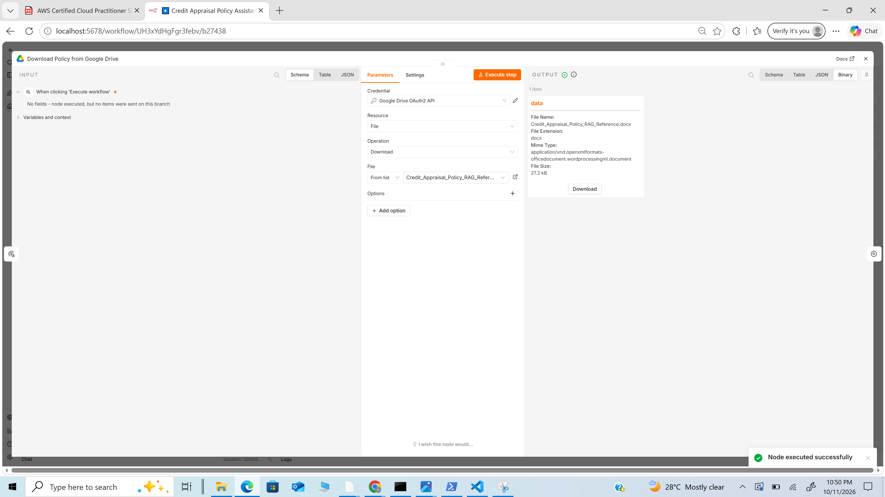
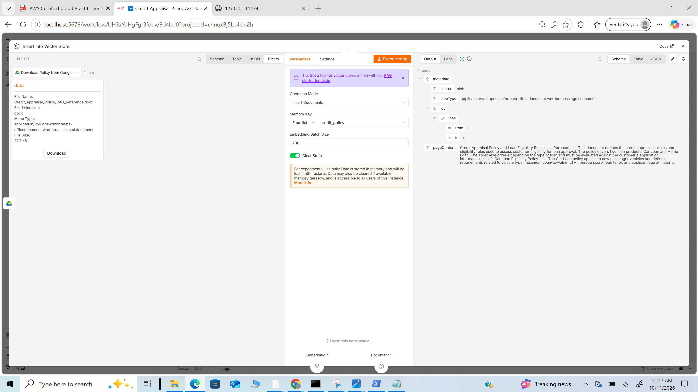
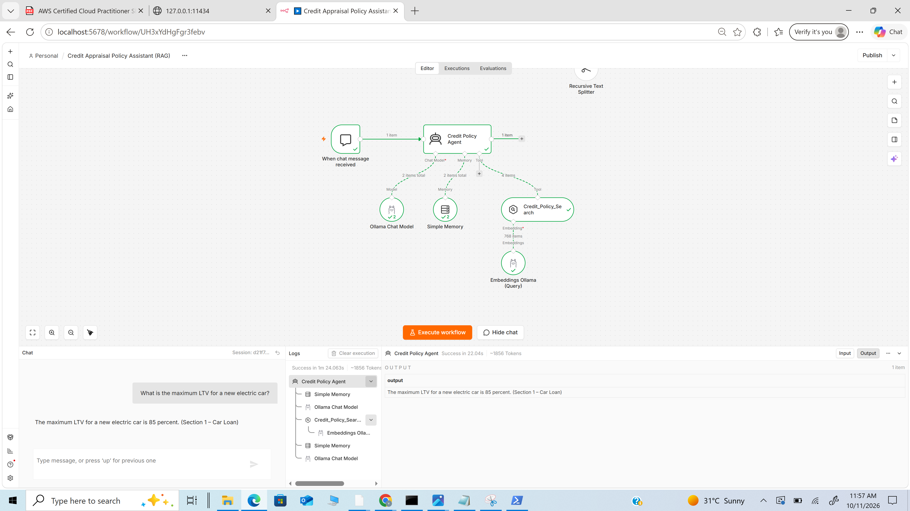
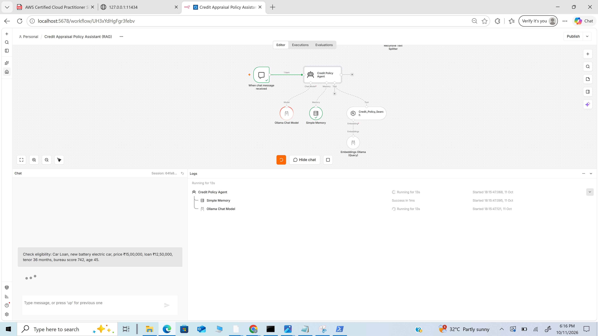
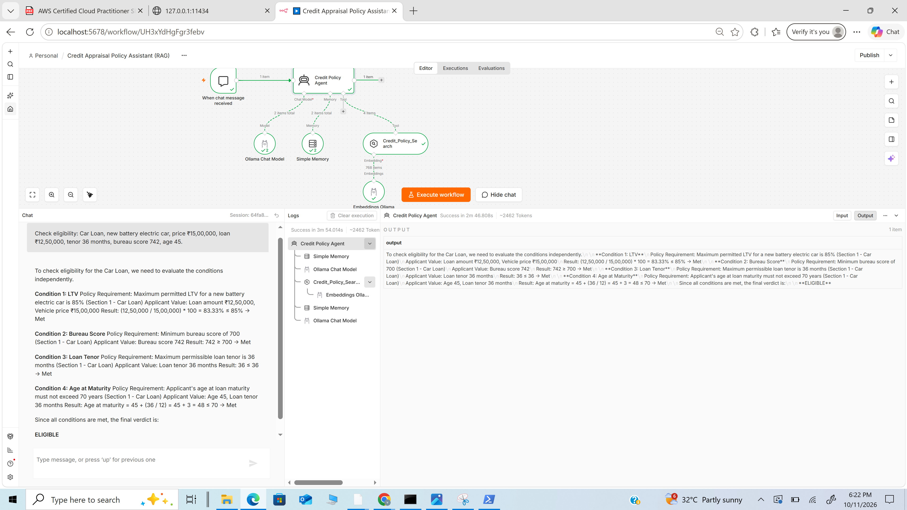

# Assignment 3 – Credit Appraisal Policy Assistant using n8n + RAG

## 1. Project Title

**Document-Grounded Credit Appraisal and Loan Eligibility Assistant using n8n and Retrieval-Augmented Generation (RAG)**

## 2. Problem Statement

A credit officer has to apply the bank's appraisal policy exactly: the right Loan-to-Value (LTV) for the right vehicle type, the bureau score cut-off, the maximum tenor, the age at maturity. A general LLM does not know this bank's policy and will confidently invent or mix up numbers (for example, applying the Home Loan FOIR rule to a Car Loan).

This assignment builds a chatbot that answers **only from the Credit Appraisal Policy document provided in class**. It can:

1. **Answer policy questions**, such as *"What is the maximum LTV for an electric car?"*
2. **Check an applicant's eligibility** condition by condition, such as *"45-year-old, EV costing ₹15 lakh, loan ₹12.5 lakh, 36 months, bureau 742: eligible?"*

When something is not in the policy, it says so instead of guessing.

## 3. Domain and Knowledge Base

**Domain:** Financial Services – Credit Appraisal and Loan Eligibility.

**Knowledge base:** `knowledge-base/Credit_Appraisal_Policy_RAG_Reference.docx` (the reference document given in class).

| Parameter | Car Loan (Section 1) | Home Loan (Section 2) |
|---|---|---|
| Maximum LTV | 80% (new petrol/diesel) · 85% (new battery electric) | 80% |
| Minimum bureau score | 700 | 700 |
| Maximum FOIR | *Not specified* | 50% |
| Maximum tenor | 36 months | 20 years |
| Maximum age at loan maturity | 70 years | 70 years |

Section 3 (Policy Application Guidelines) says to identify the loan product first, apply only that product's rules, evaluate each condition independently, and state clearly when a parameter is not in the policy. The agent's system prompt is built directly on these three guidelines.

## 4. RAG Approach

**Vector-based RAG with agentic retrieval.** The retriever is connected to the AI Agent as a **tool**, so the agent decides when to search and can search again (for example once for "Car Loan LTV" and once for "Car Loan tenor").

### Stage 1 – Ingestion (from Google Drive)
1. A **Manual Trigger** starts the ingestion.
2. The **Google Drive – Download File** node downloads `Credit_Appraisal_Policy_RAG_Reference.docx` from Google Drive.
3. The **Default Data Loader** (auto-detect, handles DOCX and PDF) extracts the text.
4. The **Recursive Character Text Splitter** cuts it into 600-character chunks with an 80-character overlap. The document is short, so small chunks keep each rule in its own retrievable piece.
5. **Ollama `nomic-embed-text`** converts each chunk into a vector.
6. The vectors are stored in the n8n **Simple Vector Store** under the key `credit_policy`. The store is cleared on each run, so re-running does not duplicate chunks.

### Stage 2 – Question Answering (Chat)
1. The user asks a question or gives applicant details in the n8n chat.
2. The **Credit Policy Agent** (Ollama `llama3.1`, temperature 0) identifies the loan product and calls `Credit_Policy_Search`.
3. The query is embedded and the 4 most similar chunks are retrieved.
4. The agent answers only from those chunks. For an eligibility check, it builds a table of conditions with Met / Not Met / Not Provided and gives a final verdict.
5. **Simple Memory** keeps the last 6 exchanges, so the user can ask *"what if the tenor is 15 years?"*

## 5. Tools and Models

| Component | Choice |
|---|---|
| Orchestration | n8n (self-hosted) |
| **LLM** | **`llama3.1:latest`** (Llama 3.1 8B) via Ollama, temperature 0 |
| **Embedding model** | **`nomic-embed-text:latest`** via Ollama |
| Vector store | n8n Simple Vector Store (in-memory) |
| Chunking | Recursive Character Text Splitter, 600 / 80 |
| Memory | Simple Memory (window of 6) |
| Document source | Google Drive (OAuth2 credential) |
| Interface | n8n Chat |

## 6. Workflow Architecture

```text
PART 1 – INGESTION
Manual Trigger ──► Google Drive: Download File ──► Insert into Vector Store ◄── Embeddings Ollama (nomic-embed-text)
                                                          ▲
                                                  Default Data Loader (DOCX)
                                                          ▲
                                             Recursive Text Splitter (600/80)

PART 2 – CHAT
When chat message received ──► Credit Policy Agent
                                 ├── Ollama Chat Model (llama3.1)
                                 ├── Simple Memory
                                 └── Credit_Policy_Search (vector store as tool)
                                          └── Embeddings Ollama (nomic-embed-text)
```

## 7. Setup and Run

### 7.1 Models
```bash
ollama pull llama3.1
ollama pull nomic-embed-text
```

### 7.2 Put the policy on Google Drive
Upload `knowledge-base/Credit_Appraisal_Policy_RAG_Reference.docx` to your Google Drive. Keep it as a **.docx**: if Drive asks to convert it to Google Docs format, choose no.

### 7.3 Create the Google Drive credential (one-time)
Self-hosted n8n needs your own Google OAuth app to access Drive.

1. Go to **console.cloud.google.com**, sign in, and **create a new project** (for example `n8n-rag`).
2. **APIs & Services → Library →** search **Google Drive API → Enable**.
3. **APIs & Services → OAuth consent screen** (shown as *Google Auth Platform* in newer consoles): User type **External**; fill in an app name and your email; under **Audience / Test users**, **add your own Gmail address**.
4. **APIs & Services → Credentials → Create Credentials → OAuth client ID**: Application type **Web application**; under **Authorised redirect URIs** add
   `http://localhost:5678/rest/oauth2-credential/callback`
   Click **Create** and copy the **Client ID** and **Client Secret**.
5. In n8n, open the *Download Policy from Google Drive* node → **Credential → Create new → Google Drive OAuth2 API** → paste the Client ID and Secret → **Sign in with Google** → choose your account → if you see *"Google hasn't verified this app"*, click **Continue** (it is your own app) → allow access.

### 7.4 Import and connect
1. In n8n: **Workflows → Import from File →** `Credit_Appraisal_RAG_Workflow.json`.
2. *Download Policy from Google Drive* → select the credential from 7.3 → in **File**, choose `Credit_Appraisal_Policy_RAG_Reference.docx` from the list.
3. Open any Ollama node → **Credential → Create new** → Base URL `http://127.0.0.1:11434` → Save. Select the same credential on the other two Ollama nodes. (On Windows, `127.0.0.1` worked where `localhost` failed. If the model list shows "Error fetching options", refresh the page with Ctrl+F5.)

### 7.5 Run
1. **Ingest:** click **Execute workflow** (or the play button on the Manual Trigger). *Download Policy from Google Drive* shows the file and *Insert into Vector Store* shows the stored chunks.
2. **Chat:** click **Open chat** at the bottom of the canvas and ask the test questions below.

> The Simple Vector Store lives in memory. After restarting n8n (or after the laptop sleeps), run the ingestion again before chatting. The first chat answer can take 30–60 seconds while Ollama loads the model.

## 8. Test Results

| # | Question sent in chat | Bot's answer | Result |
|---|---|---|---|
| 1 | What is the maximum LTV for a new electric car? | "The maximum LTV for a new electric car is 85 percent. (Section 1 – Car Loan)" | Correct, with section reference; logs show `Credit_Policy_Search` retrieved 4 chunks |
| 2 | Check eligibility: Car Loan, new battery electric car, price ₹15,00,000, loan ₹12,50,000, tenor 36 months, bureau score 742, age 45 | Table: LTV 83.33% ≤ 85% Met · Bureau 742 ≥ 700 Met · Tenor 36 ≤ 36 months Met · Age at maturity 45 + 3 = 48 ≤ 70 Met → **ELIGIBLE** | Correct |

### Prompt refinement made during testing
On the first run of question 2, `llama3.1` (8B) mis-computed the age at maturity (45 + 36/12 written as 51) and then marked 51 ≤ 70 as *Not Met*, giving a wrong NOT ELIGIBLE verdict. Retrieval was correct; the error was in the model's arithmetic and comparison. Rule 4 of Mode B was rewritten to spell out how "≤" and "≥" limits are judged, with a worked example (age 45 + 36 months → 48 ≤ 70 → Met). After this change the same question returned the correct **ELIGIBLE** verdict. The updated prompt is in the workflow and in `Prompts.md`.

### Other questions the assistant supports
| Question | Expected answer |
|---|---|
| Car Loan, petrol car, price ₹15,00,000, loan ₹12,50,000, 36 months, bureau 742, age 45 | NOT ELIGIBLE: LTV 83.3% > 80% |
| Home Loan, property ₹80,00,000, loan ₹60,00,000, FOIR 45%, bureau 760, age 55, tenor 20 years | NOT ELIGIBLE: age at maturity 75 > 70 |
| *(follow-up)* What if the tenor is 15 years? | ELIGIBLE: 55 + 15 = 70 |
| What is the maximum FOIR for a Car Loan? | Not available in the provided policy for Car Loan (FOIR exists only for Home Loan) |
| What is the minimum income required for a Home Loan? | Not available in the provided policy |

## 9. Screenshots

**Figure 1 – Full workflow: ingestion from Google Drive + chat agent**


**Figure 2 – Google Drive node downloading the policy document**



**Figure 3 – Policy chunks embedded and stored in the vector store**



**Figure 4 – Policy question answered with the section reference**



**Figure 5 – Execution log: Credit_Policy_Search tool call and retrieved chunks**



**Figure 6 – Eligibility check: condition table and ELIGIBLE verdict**



## 10. Why RAG Here

- **Grounded values:** the LTV, tenor and score limits are this policy's own numbers, not general knowledge. Retrieval makes the model use the document instead of its memory.
- **Product separation:** the prompt and tool description make the agent name the loan product in every search, which stops it from mixing Car and Home Loan rules.
- **No hallucination:** the agent is instructed to say "not available in the provided policy" for FOIR on Car Loans or income requirements, as Section 3 of the policy requires.
- **Easy to update:** when the policy changes, replace the file on Google Drive and re-run ingestion. No retraining is needed.
- **Data stays local:** both the LLM and the embeddings run on Ollama, so policy and applicant details stay on the machine.

## 11. Files

| File | Description |
|---|---|
| `Credit_Appraisal_RAG_Workflow.json` | Importable n8n workflow |
| `knowledge-base/Credit_Appraisal_Policy_RAG_Reference.docx` | Knowledge base (given in class) |
| `Prompts.md` | System prompt, tool description and models used |
| `screenshots/` | Proof of execution |
