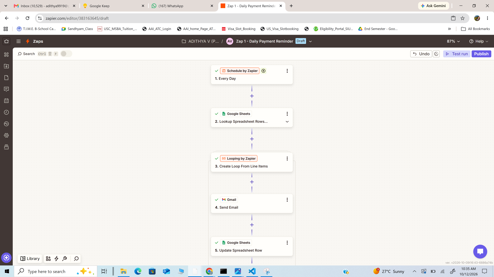
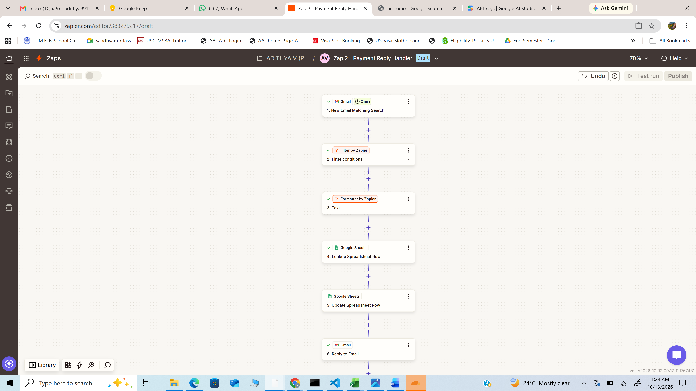
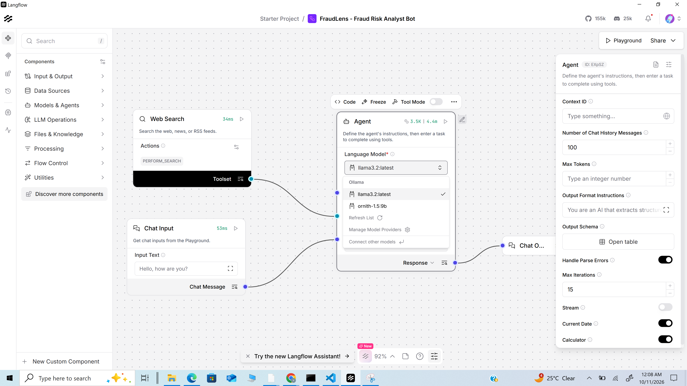
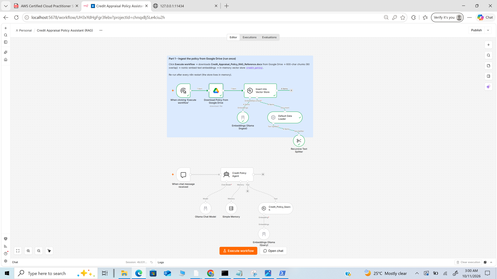
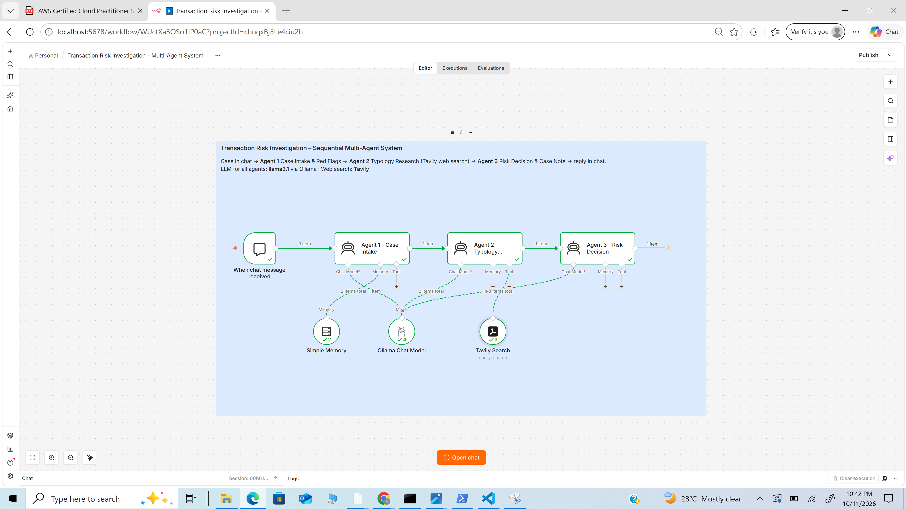

# Agentic AI – Course Assignments

**Adithya V** · MBA (Data Science & Data Analytics), SCIT Pune · Batch 2025–27

This repository contains the four Agentic AI course assignments. Each folder includes the workflow, the prompts, the LLM used, and screenshots as proof of execution.

| # | Assignment | Use case | Platform | LLM | Status |
|---|---|---|---|---|---|
| 1 | [Zapier – scheduled mail + reply handling](Assignment-1-Zapier-Invoice-Reminder) | Daily invoice payment reminders; "Payment Done" replies automatically mark the invoice Completed and send an acknowledgement | Zapier, Google Sheets, Gmail | None (rule-based automation) | Done |
| 2 | [LangFlow – smart bot](Assignment-2-LangFlow-Fraud-Analyst-Bot) | **FraudLens:** fraud risk analyst agent with a 7-section case assessment, chat memory and a web search tool | LangFlow | `llama3.2` via Ollama | Done |
| 3 | [n8n + RAG](Assignment-3-n8n-RAG-Credit-Appraisal) | Credit appraisal assistant on the class policy document (loaded from Google Drive): answers Car/Home Loan policy questions and checks applicant eligibility condition by condition | n8n, Google Drive | `llama3.1` + `nomic-embed-text` via Ollama | Done |
| 4 | [n8n + Multi-Agent System](Assignment-4-n8n-MAS-Transaction-Risk) | 3-agent transaction risk investigation: intake → web research (Tavily) → risk decision | n8n, Tavily | `llama3.1` via Ollama | Done |

Assignments 2–4 share one theme, **risk in banking** (fraud, credit appraisal, transaction risk), and use a local LLM through Ollama, so case and policy details are not sent to a cloud LLM.

## Workflow previews

**Assignment 1 – Invoice Reminder (Zapier)**

Zap 1 – daily reminder to every Pending invoice:



Zap 2 – "Payment Done" reply marks the invoice Completed and sends an acknowledgement:



**Assignment 2 – FraudLens (LangFlow)**



**Assignment 3 – Credit Appraisal RAG (n8n)**



**Assignment 4 – Transaction Risk Multi-Agent System (n8n)**



More screenshots (chat outputs, tool calls, execution logs) are in each assignment's README.

## Folder contents

```text
Assignment-1-Zapier-Invoice-Reminder/   README · Prompt.md · SCIT_Invoice_Tracker.xlsx · screenshots/
Assignment-2-LangFlow-Fraud-Analyst-Bot/ README · Prompts.md · FraudLens_Flow.json · screenshots/
Assignment-3-n8n-RAG-Credit-Appraisal/   README · Prompts.md · Credit_Appraisal_RAG_Workflow.json · knowledge-base/ · screenshots/
Assignment-4-n8n-MAS-Transaction-Risk/   README · Prompts.md · Transaction_Risk_MAS_Workflow.json · screenshots/
```

## Common setup

```bash
# Local models
ollama pull llama3.2           # Assignment 2
ollama pull llama3.1           # Assignments 3 and 4
ollama pull nomic-embed-text   # Assignment 3 embeddings

# n8n (self-hosted)
npx n8n            # opens at http://localhost:5678
```
